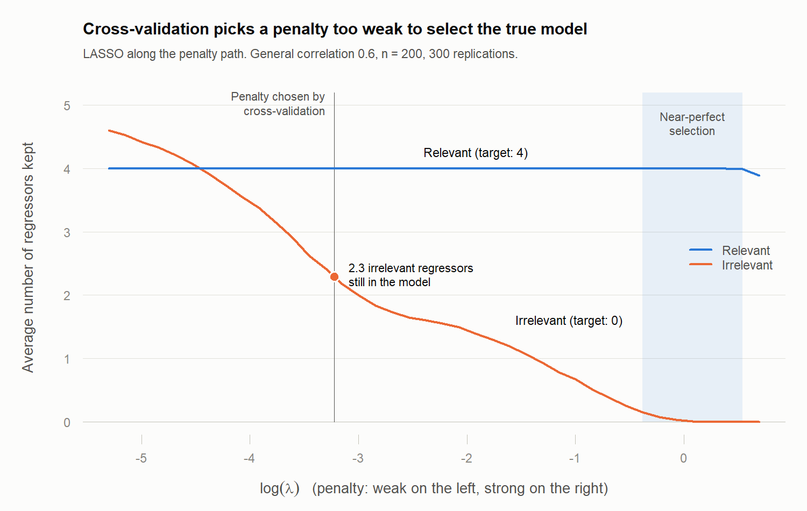
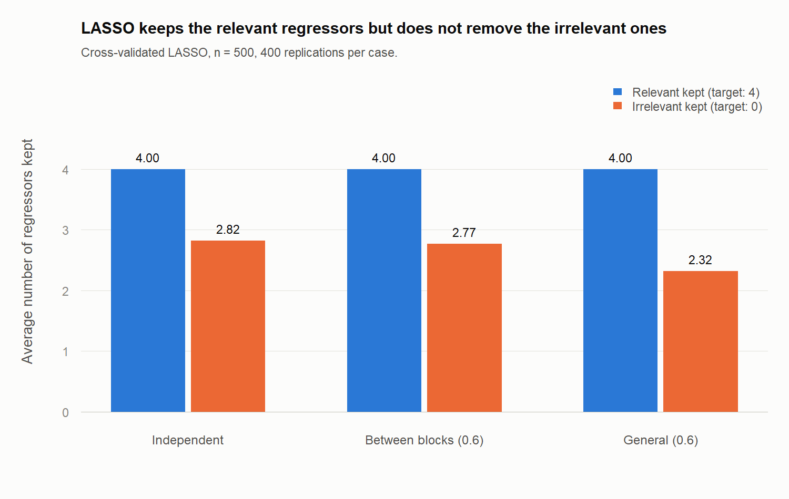
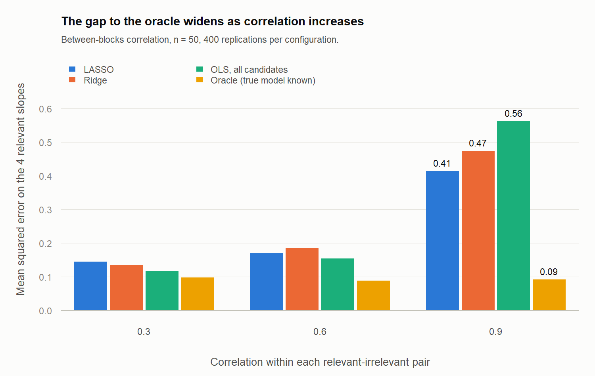

# Why cross-validated LASSO misses the true model

**A Monte Carlo study of Ridge and LASSO variable selection under correlated regressors**



LASSO is often presented as a method that selects the right variables automatically. This project tests that claim in a controlled setting where the true model is known: 4 relevant regressors hidden among 9 candidates, with three correlation structures and two sample sizes.

## Key results

1. **LASSO almost never finds the true model.** It recovers exactly the 4 relevant regressors in only 3% to 9% of samples. This holds with or without correlation, and a larger sample (n = 500 instead of 50) does not fix it.
2. **The cause is the penalty chosen by cross-validation, not correlation.** LASSO keeps all 4 relevant regressors but also 2 to 3 of the 5 irrelevant ones. A penalty roughly 20 to 40 times stronger would select almost perfectly (figure above), but cross-validation does not choose it because it optimises prediction, not identification.
3. **Ridge does not select at all.** It keeps all 9 candidates in 100% of samples, as its quadratic penalty implies.
4. **Correlation is paid for in precision.** With a correlation of 0.9 between relevant and irrelevant regressors and n = 50, the estimation error of LASSO, Ridge and full OLS is 4 to 6 times that of an oracle who knows the true model.

Every number below is reproduced exactly from a fixed seed. The output is identical on Windows (R 4.4.1) and Linux (R 4.3.3) with glmnet 4.1-8.

## Design

**True model.** $y = 1 + x_2 + x_3 + x_4 + x_5 + u$, with $u \sim N(0, 1)$.

**Candidates.** A constant and 9 random regressors: 4 relevant ($x_2$ to $x_5$) and 5 irrelevant ($x_6$ to $x_{10}$, true coefficient 0).

**Correlation.** The regressors are generated as $X = ZC'$ from independent normal factors $Z$, so their covariance matrix is $\Sigma = CC'$. Choosing $C$ and reading the correlation off $\Sigma$ guarantees a valid (positive definite) covariance matrix in every configuration.

| Case | Structure | Correlation levels |
|---|---|---|
| Independent | $\Sigma = I$ | 0 |
| Between blocks | Each relevant regressor is correlated with one irrelevant regressor, and with nothing else | 0.3, 0.6, 0.9 |
| General | All regressors are equally correlated | 0.3, 0.6, 0.9 |

**Grid.** 14 configurations (case × correlation × n ∈ {50, 500}), 400 replications each.

**Estimators.**

| Estimator | Description |
|---|---|
| LASSO | Penalty chosen by 5-fold cross-validation (`lambda.min`) |
| Ridge | Penalty chosen by 5-fold cross-validation (`lambda.min`) |
| OLS, all candidates | No penalty, all 9 regressors |
| Oracle | OLS on the 4 relevant regressors only. Not available in practice, used as the best achievable benchmark |

## Results

### Selection

Average number of regressors kept by cross-validated LASSO, and share of samples in which it keeps exactly the 4 relevant regressors.

| Case | Correlation | n | Relevant kept (of 4) | Irrelevant kept (of 5) | True model recovered |
|---|---|---|---|---|---|
| Independent | 0 | 50 | 4.00 | 2.99 | 4.5% |
| Independent | 0 | 500 | 4.00 | 2.82 | 7.8% |
| Between blocks | 0.3 | 50 | 4.00 | 2.98 | 7.2% |
| Between blocks | 0.3 | 500 | 4.00 | 2.75 | 6.2% |
| Between blocks | 0.6 | 50 | 4.00 | 2.92 | 5.8% |
| Between blocks | 0.6 | 500 | 4.00 | 2.77 | 3.0% |
| Between blocks | 0.9 | 50 | 3.98 | 3.02 | 3.0% |
| Between blocks | 0.9 | 500 | 4.00 | 2.83 | 3.2% |
| General | 0.3 | 50 | 4.00 | 2.40 | 9.2% |
| General | 0.3 | 500 | 4.00 | 2.41 | 7.5% |
| General | 0.6 | 50 | 4.00 | 2.52 | 5.2% |
| General | 0.6 | 500 | 4.00 | 2.32 | 8.2% |
| General | 0.9 | 50 | 3.90 | 2.33 | 7.0% |
| General | 0.9 | 500 | 4.00 | 1.87 | 8.0% |

LASSO does not omit relevant regressors. Its failure is over-inclusion, and it is already there when the regressors are independent.



### Does correlation change which variables LASSO keeps?

Mostly not. In the between-blocks case, an irrelevant regressor correlated with a relevant one is kept in 52% to 62% of samples. An irrelevant regressor with no correlation at all is kept in 55% to 64% of samples (independent case). The two rates are the same: correlation with a relevant regressor does not make an irrelevant regressor more likely to be selected.

Correlation matters in one extreme configuration. With general correlation 0.9 and n = 50, LASSO drops at least one relevant regressor in 12% of samples. This never happens in the other configurations.

*Note: the per-regressor selection frequencies (`results/selection_frequency.csv`) were added for this repository. They refine the reading given in section 4.2 of the thesis, which did not compare the paired regressors with this baseline.*

### Estimation error

Mean squared error on the 4 relevant coefficients, between-blocks case, n = 50.

| Correlation | LASSO | Ridge | OLS, all candidates | Oracle |
|---|---|---|---|---|
| 0.3 | 0.145 | 0.134 | 0.118 | 0.097 |
| 0.6 | 0.169 | 0.184 | 0.154 | 0.088 |
| 0.9 | 0.414 | 0.474 | 0.562 | 0.092 |



The oracle is unaffected by this correlation, because the irrelevant regressors are not in its model. Every procedure that has to deal with them loses precision as correlation rises. LASSO does better than full OLS at high correlation but stays far from the oracle.

## Reproduce

Requirements: R (4.3 or later) and the `glmnet` package.

```r
install.packages("glmnet")
```

```bash
git clone https://github.com/souhail-elfahi/lasso-ridge-monte-carlo.git
cd lasso-ridge-monte-carlo
Rscript scripts/01_run_simulation.R   # about 10 minutes, writes results/
Rscript scripts/02_make_figures.R     # writes figures/
```

In RStudio: open `lasso-ridge-monte-carlo.Rproj`, then run `source("scripts/01_run_simulation.R")` and `source("scripts/02_make_figures.R")`.

The software versions of the committed run are recorded in `results/session_info.txt`.

## Repository structure

```
R/
  dgp.R                   data-generating process (the three C matrices)
  estimators.R            LASSO, Ridge, OLS and oracle
  experiments.R           the Monte Carlo experiments
scripts/
  01_run_simulation.R     runs everything, writes results/*.csv
  02_make_figures.R       draws the figures from the CSV files
results/                  simulation output
figures/                  figures used in this README
```

## Limits

- The general case is an equicorrelation structure. Heterogeneous correlation patterns are not covered.
- All true coefficients equal 1. Weak coefficients would probably be harder to select, but this was not tested.
- A simulation study characterises behaviour in the configurations it covers. It is not an analytical proof.

## Context

This project comes from my M1 thesis in Applied Econometrics at Université de Lille (2025-2026): *Performance des procédures Ridge et LASSO de sélection de régresseurs en présence de corrélation entre les régresseurs*.

Main references: Hoerl and Kennard (1970), Tibshirani (1996), Hastie, Tibshirani and Friedman (2009), Greene (2012).

## Résumé en français

Cette étude de Monte Carlo évalue la capacité des régressions Ridge et LASSO à identifier le vrai modèle lorsque les régresseurs candidats sont corrélés. Le LASSO conserve les 4 vraies variables mais garde aussi 2 à 3 des 5 variables excédentaires, et ne retrouve exactement le vrai modèle que dans 3 à 9 % des cas, quelle que soit la corrélation ou la taille de l'échantillon. La cause principale est le choix de la pénalité par validation croisée, qui vise la prédiction et non l'identification. Ridge ne sélectionne jamais. La corrélation dégrade surtout la précision de l'estimation des coefficients par rapport à un oracle qui connaîtrait le vrai modèle.

## Author

Souhail Elfahi, M2 Data Science for Economics, Université de Lille. [LinkedIn](https://www.linkedin.com/in/souhail-elfahi)
